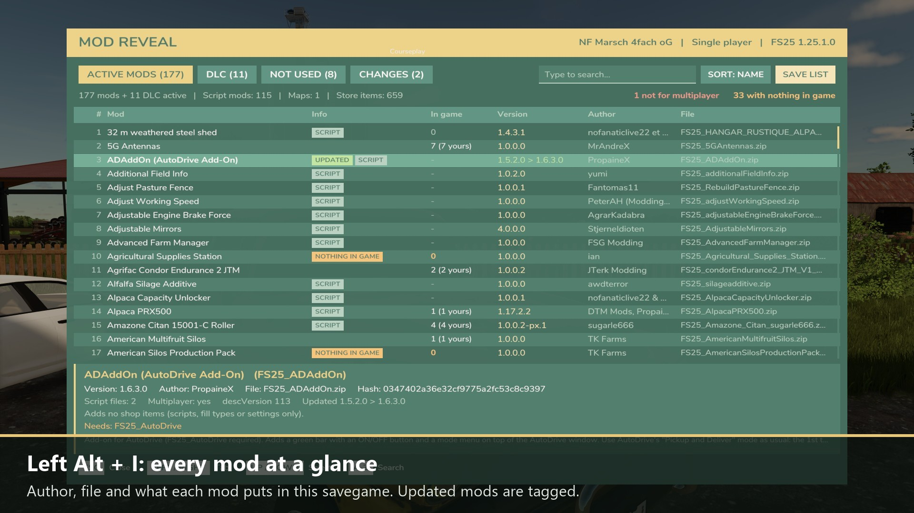
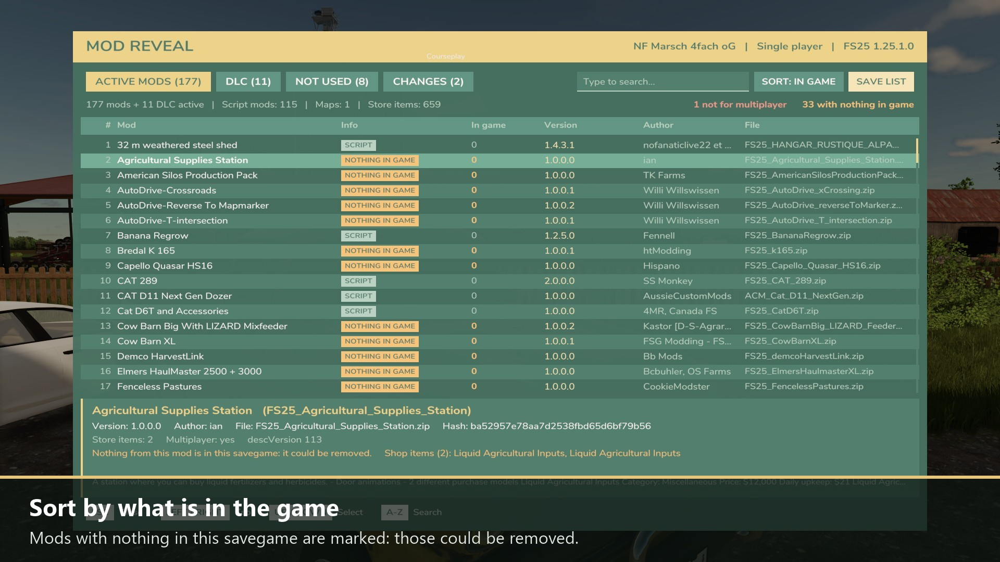
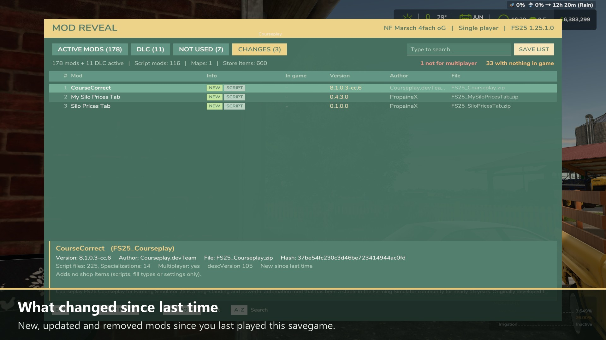
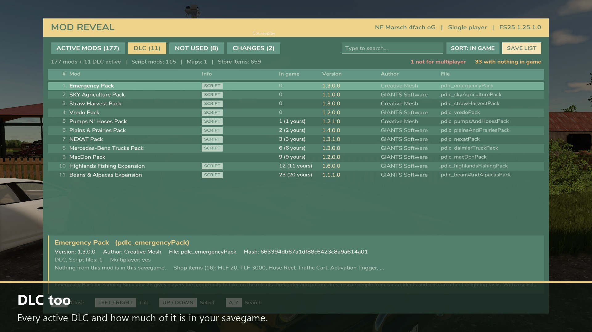

  

  

<h1 align="center">Mod Reveal</h1>

  
  
  

  <b>Shows every mod your game runs, with its version.</b> 
  by Fennell

  

Press **Left Alt + I** in game.

- **Active mods**: every loaded mod with version, author and file name. Tags show maps, script mods, mods that don't support multiplayer (**NO MP**), unzipped folders (**FOLDER**, multiplayer only takes zips) and possible duplicates (two active mods with the same name).
- **DLC**: the DLCs in use.
- **Not used**: mods in your mods folder that this savegame or server doesn't load.
- **Changes**: what was **updated**, **added** or **removed** since you last played this savegame or server, including "same version, new file" (a rebuilt zip). After a change you get a short message on screen when the game starts.
- **In game**: how many vehicles, pallets, buildings and hand tools from each mod are in your savegame (and how many are yours). Mods that only add shop items and have nothing in the savegame are tagged **NOTHING IN GAME**: candidates to remove from the server. **SORT: IN GAME** lists them first.
- **Details** of the selected mod: mod name, file hash (the one the server compares when you join), number of scripts, specializations and store items, the mods it needs, what it puts in the shop, its descVersion and the start of its description.
- **Search** by just typing (name, author, file or version). **SORT** by name, author, file or load order.
- **Mod list files**: on every load the list is written to `modSettings/FS25_ModReveal/ModList.txt` (lined up, ready to paste into Discord) and `ModList.csv` (spreadsheet). **SAVE LIST** writes them again.
- **Dedicated server**: the same files are written on the server, and the server log gets a summary line plus every change since the last start, starting with `[ModReveal]`. `Changes.txt` lists the changes of the last start for scripts; the DTM server posts it to Discord (`announce-mod-changes.ps1` in dtm-server).
- **English and German**, Left Alt + I listed in the F1 help box, gamepad buttons in the window (LB / RB tabs, B closes; bind a button to "Mod Reveal: mod list" to open it).

Keys while the list is open: Left / Right change the tab, Up / Down (hold to run) or the mouse wheel select, Esc clears the search and then closes. Click SORT for name, in game, author, file or load order.

Console: `modReveal` (the list), `modRevealExport` (write the files), `modRevealChanges` (what changed), `modRevealShow` (open the list).

It only reads; it changes nothing in the game.

<!-- dtm-screenshots -->

  

  

  
  

  

<!-- /dtm-screenshots -->

  

Download `FS25_ModReveal.zip` from the [latest release](https://github.com/DTM-Mods/FS25_ModReveal/releases/latest) and put it in `Documents/My Games/FarmingSimulator2025/mods`, without unzipping or renaming it. In multiplayer, install it on the server and on every player's game.

See [PATCH_NOTES.md](PATCH_NOTES.md) for what changed in each version.

<b>For developers</b>

- `scripts/ModReveal.lua`: reads the mod list (`g_modManager:getActiveMods()`, `getMods()` for the unused ones, each active mod's modDesc.xml for the rest), change tracking (`modSettings/FS25_ModReveal/lastSeen_<savegameN | server_name>.xml`), the files, log and console.
- `scripts/ModRevealDisplay.lua`: the window, drawn with `drawFilledRect` / `renderText` in its own input context (same scheme as Monthly Expense Sheet).
- `translations/l10n_en.xml`, `l10n_de.xml`: all texts.
- In game: `ModReveal.computeUsage()` counts `g_storeManager:getItems()`, `vehicleSystem.vehicles`, `placeableSystem.placeables` and `handToolSystem.handTools` by `.customEnvironment` (the mod they came from), on every open and 20 s after loading.
- Build: `python -I tools\build_zip.py dist\FS25_ModReveal.zip` (forward-slash paths, checks every entry).
- Test: `python tests/test_offline.py` runs both scripts in `lupa` with engine stubs (needs `pip install lupa`).
- Icon: `_brand/tools/make_icons.py <brand> <work> modReveal`, then GIANTS `textureTool.exe icon_ModReveal.png` makes the .dds.

  

MIT, see [LICENSE](LICENSE).

---

   
  Part of <a href="https://github.com/DTM-Mods">DTM Mods</a> (Designed To Manage) by PropaineX & Fennell  
  
   
  
  
  

